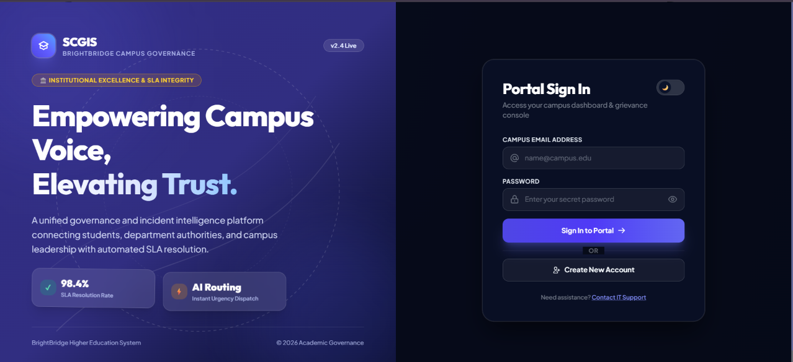
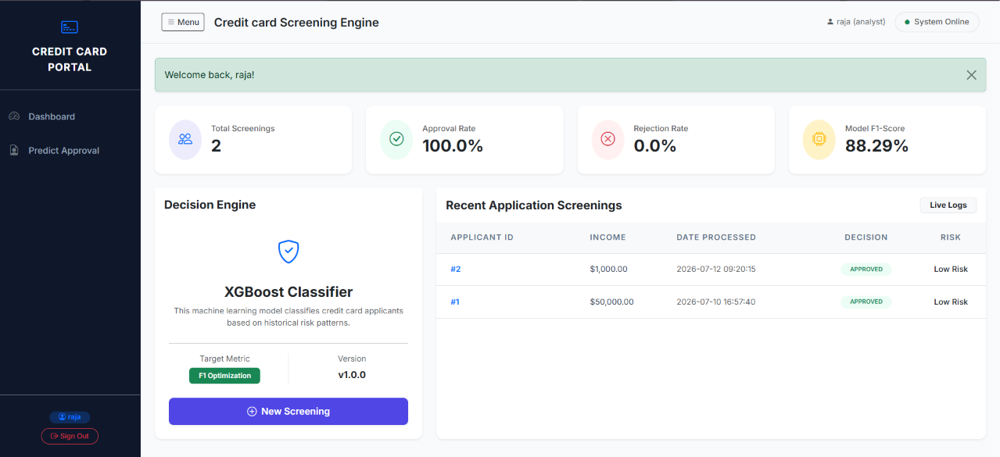
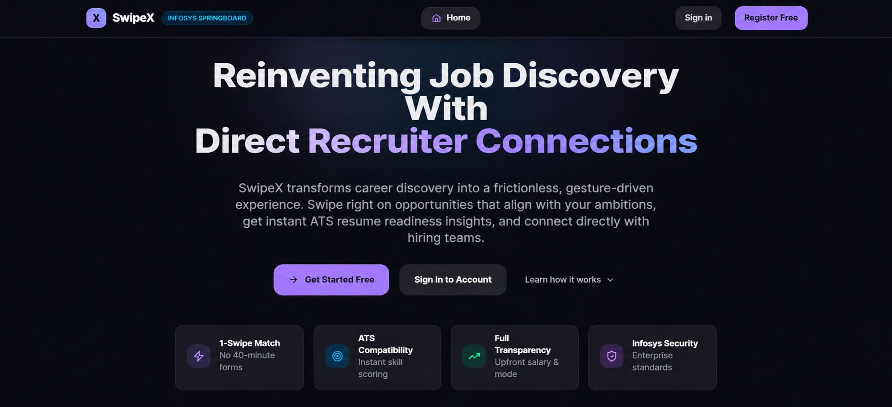

<!-- ==================== PROFILE HEADER ==================== -->

  

  
  
  
  </a>
  
  

<!-- ABOUT ME -->
<h2 align="left">👨‍💻 About Me</h2>

  I'm a Computer Science and Engineering student specializing in
  <strong>Artificial Intelligence and Machine Learning</strong>, passionate about
  developing practical software solutions and exploring emerging technologies.

<ul>
  <li>🎓 Pursuing B.Tech in Computer Science and Engineering (AI & ML).</li>
  <li>💻 Interested in Full-Stack Development and AI/ML applications.</li>
  <li>🤖 Exploring intelligent workflow automation using n8n and Zapier.</li>
  <li>🌱 Continuously learning, solving problems, and building meaningful projects.</li>
</ul>

<!-- TECHNICAL SKILLS & TOOLS -->
<h2 align="center">🛠️ TECH STACK & TOOLS</h2>

<h4 align="center">Programming Languages</h4>

  
  
  

<h4 align="center">Frontend Development</h4>

  
  
  

<h4 align="center">Backend Development</h4>

  
  
  

<h4 align="center">Data Science & Databases</h4>

  
  
  
  

<h4 align="center">Tools & Automation</h4>

  
  
  
  

<h2 align="left">🌐 Internship Experience</h2>
<table>
  <tr>
    <td width="50%" valign="top">
      <h3>🚀 Full-Stack Development Intern</h3>
      
<strong>CodeAlpha</strong>

      

        
        
      

      <ul>
        <li>Completed the CodeAlpha internship in Full-Stack Development.</li>
        <li>Gained practical exposure to frontend development and building web-based solutions.</li>
        <li>Received an internship completion certificate.</li>
      </ul>
    </td>
    <td width="50%" valign="top">
      <h3>🤖 Virtual Intern — AI/ML Track</h3>
      
<strong>Infosys Springboard — Virtual Internship 7.0</strong>

      

        
      

      <ul>
        <li>Selected for the Infosys Springboard Virtual Internship 7.0.</li>
        <li>Part of the Artificial Intelligence and Machine Learning track.</li>
        <li>Focused on building knowledge in AI/ML through the virtual internship program.</li>
      </ul>
    </td>
  </tr>
</table>
<!-- FEATURED PROJECTS -->

<!-- ==================== FEATURED PROJECTS ==================== -->
<h2 align="center">🚀 FEATURED PROJECTS</h2>

  A selection of applications and solutions I've worked on.
   
  Click any project preview to open its live application.

<!-- PROJECT 01: SCGIS -->
<h3>01 · 🏫 Intelligent Campus Governance &amp; Analytics Platform</h3>

  

  A full-stack campus governance platform that helps students raise and track grievances,
  enables department heads to manage resolutions, and gives administrators visibility into
  institutional performance through analytics and SLA monitoring.

Key Highlights
- Role-based portals for students, department heads, and administrators.
- AI-assisted grievance categorization, urgency prioritization, and SLA escalation.
- Real-time notifications with Socket.IO and analytics dashboards with complaint trends.
Tech Stack

  
  
  
  
  
  
  

  
  

<!-- PROJECT 02: CREDIT CARD APPROVAL -->
<h3>02 · 💳 Credit Card Approval Prediction</h3>

  

  A machine-learning-powered screening application that evaluates applicant information
  and credit-history data to predict credit-card approval outcomes. It includes an analyst
  dashboard for reviewing screening activity and model performance.

Key Highlights
- Data cleaning, feature engineering, categorical encoding, and numerical scaling.
- Model evaluation and comparison across Logistic Regression, Decision Tree, Random Forest, and XGBoost.
- XGBoost selected as the champion classifier, with an SQLite-backed application database.
Tech Stack

  
  
  
  
  
  

  
  

<!-- PROJECT 03: SWIPEX -->
<h3>03 · 💼 AI-Powered Swipe-Based Job Discovery &amp; Personalized Career Intelligence</h3>

  

  SwipeX reimagines job discovery through a swipe-based experience, helping candidates
  explore opportunities aligned with their goals, review ATS resume-readiness insights,
  and connect more directly with hiring teams.

Key Highlights
- Swipe-based discovery experience for exploring relevant job opportunities.
- ATS compatibility and resume-readiness insights.
- Recruiter connectivity, salary transparency, and clear work-mode information.
Platform Highlights 

  
  
  
  

  

<!-- Add a GitHub Repository badge here when the SwipeX repository URL is available. --><!-- ================== END FEATURED PROJECTS ==================

<h2>👾 Contribution Activity</h2>

  <picture>
    <source media="(prefers-color-scheme: dark)" srcset="https://raw.githubusercontent.com/SaiRajesh01/SaiRajesh01/output/galaga-contribution-graph-dark.svg" />
    <source media="(prefers-color-scheme: light)" srcset="https://raw.githubusercontent.com/SaiRajesh01/SaiRajesh01/output/galaga-contribution-graph.svg" />
    
  </picture>

